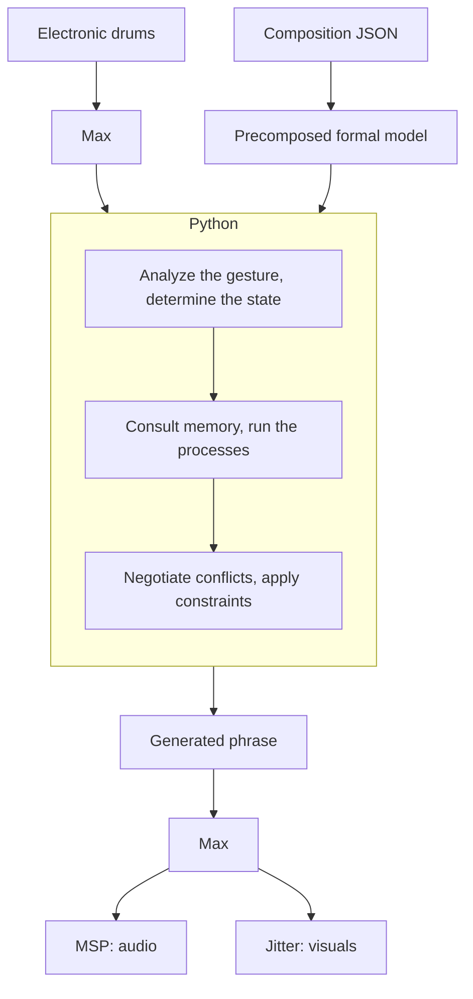

A proof of concept for computer music built from hierarchical, multi-parametric, partially independent and sometimes conflicting formal processes, and for future pieces written the same way.

A simple live performance on electronic drums supplies structure, timing and energy. A precomposed system in Python reads it according to the piece's current formal state, its memory and several processes at once, settles their conflicts, and answers through Max with musical phrases, sound and visuals.

The premise: **compositional complexity does not require equivalent physical performance complexity.** How the work is shared between performer and machine is itself part of the composition.

## Where it stands

It is built in stages, each ending in listening rather than in a passing test suite. Reading the drums into Max works; the next steps need the real kit in front of it: its pads and zones, the hi-hat pedal, and the delay from strike to sound.
